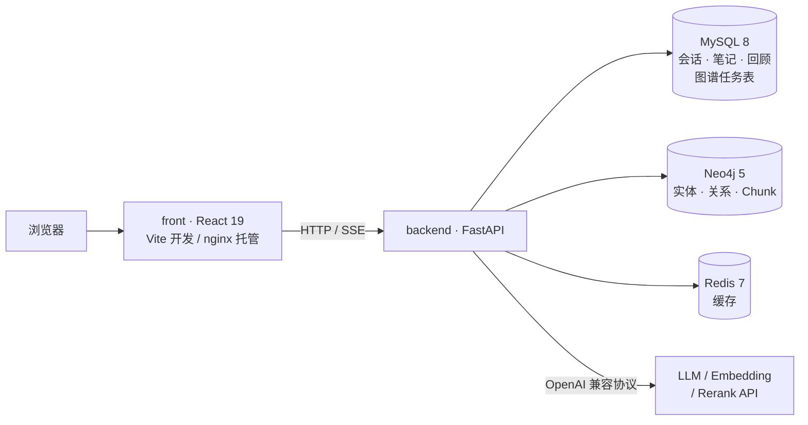
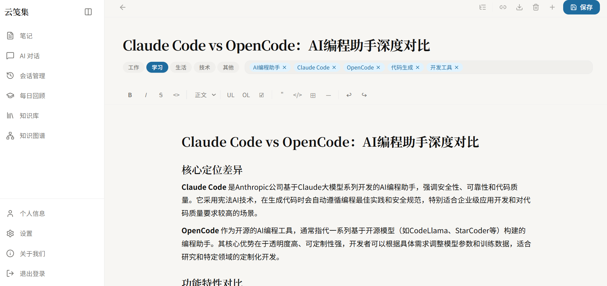
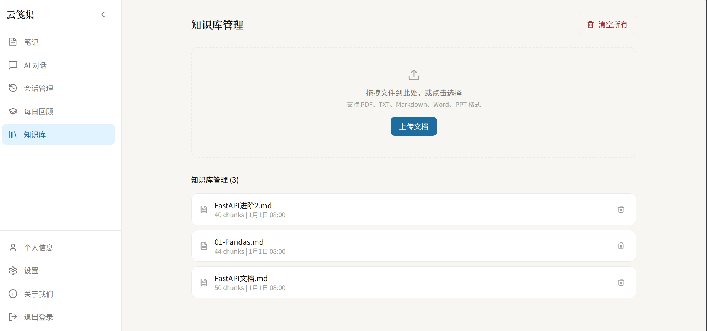
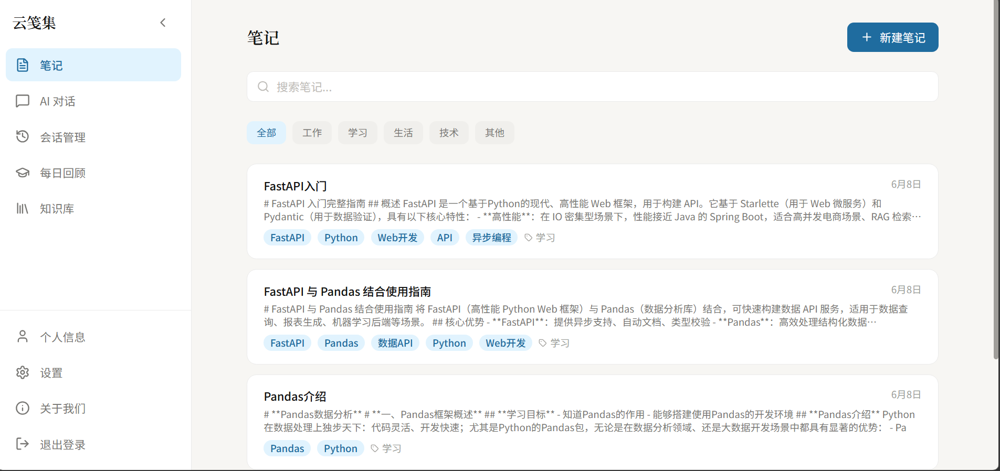
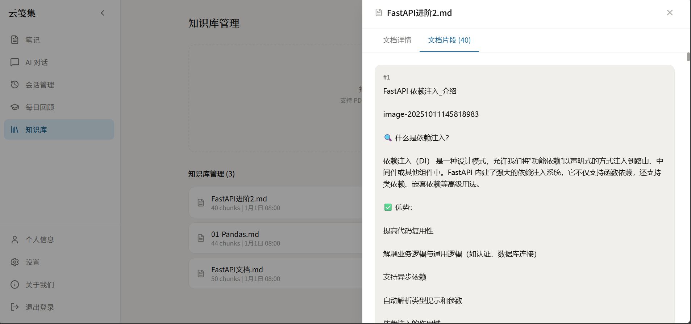
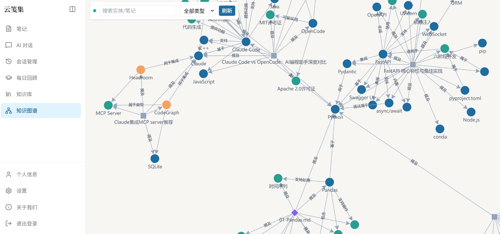
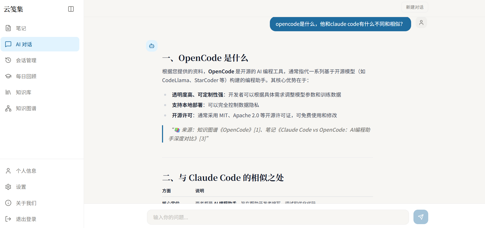

# RAG NoteBook · 智能笔记助手

<div align="center">


</div>

笔记写完就沉底，文档存着不回顾，知识散成一座座孤岛。RAG NoteBook 把**笔记**和**知识库**放进同一套检索链路：上传的文档和随手记下的笔记都会被切片、向量化、抽成实体与关系写进图数据库；提问时先由模型规划检索策略，再从笔记与文档里召回证据、沿图谱补全上下文，最后交给 Agent 作答并标出引用来源。

RAG 是这套系统的引擎，笔记和图谱是它服务的对象，不是并列的三个功能。

---

## 目录

- [功能特性](#功能特性)
- [系统架构](#系统架构)
- [界面预览](#界面预览)
- [快速开始](#快速开始)
- [技术栈](#技术栈)
- [目录结构](#目录结构)
- [API 一览](#api-一览)
- [实现要点](#实现要点)
- [配置说明](#配置说明)
- [测试](#测试)
- [常见问题](#常见问题)
- [许可](#许可)

## 功能特性

| 模块 | 能力 | 代码位置 |
|------|------|----------|
| **笔记管理** | Tiptap 富文本 + Markdown、`[[双链]]`、大纲跳转、分类与置顶、批量删除/下载/改分类、导出 `.md` | `app/router/note_router.py` |
| **智能标签** | 保存后异步调 LLM 打标签并归入工作/学习/生活/项目 | `POST /note/{note_id}/auto-tag` |
| **语义搜索** | Neo4j 向量索引与全文索引双路召回，RRF 融合排序 | `GET /note/search` |
| **间隔重复** | 艾宾浩斯曲线 1/2/4/7/15/30 天，每日到期清单 + 自测题 + 标记已复习 | `app/services/review_service.py` |
| **AI 写作辅助** | 打字停顿后实时补全（Tab 采纳）、续写/扩写/摘要，SSE 流式返回 | `POST /note/autocomplete`、`/note/assist/stream` |
| **关联推荐** | 编辑笔记时从笔记库与知识库双向召回 Top-k 相关片段 | `GET /note/{note_id}/related` |
| **知识库** | TXT/PDF/MD/PPTX/DOCX 上传、MD5 去重、切片详情可视化、按文件名或 MD5 删除 | `app/router/knowledge_router.py` |
| **知识图谱** | LLM 抽取实体与关系、画布浏览、实体合并/编辑、类型管理、抽取日志 | `app/graph/routers/graph_router.py` |
| **智能问答** | Agent 工具调用 + 人工审批 + 图谱引导 RAG，SSE 流式，回答附来源 | `app/router/chat.py` |
| **用户与隔离** | JWT 登录/注册/刷新令牌、头像上传；所有查询按 `user_id` 隔离 | `app/router/user.py` |
| **多语言** | 中/英界面切换 | `front/src/i18n` |

## 系统架构



一次提问会穿过三层：

1. **Agent 层**（`app/agent/`）——`create_agent` 编译的 LangGraph 图，挂了搜索笔记、创建笔记、查回顾、查时间等工具，状态存 MySQL checkpoint，写操作走人工审批。
2. **检索层**（`app/rag/agentic_rag/`）——planner 出检索计划，图检索与文本检索并行执行，evaluator 判断证据够不够，最后融合成一段 context。
3. **存储层**——MySQL 存业务数据与任务，Neo4j 存知识图谱和 Chunk 向量，Redis 做缓存。

## 界面预览

| 笔记编辑 | 知识库 |
|:--:|:--:|
|  |  |

| 笔记列表 | 切片详情 |
|:--:|:--:|
|  |  |

| 知识图谱 | 对话检索 |
|:--:|:--:|
|  |  |

## 快速开始

### 方式一：Docker 一键启动（推荐）

前置：已安装并启动 [Docker Desktop](https://www.docker.com/products/docker-desktop/)，建议内存 ≥ 4GB；首次构建约 10 分钟（后端依赖含 torch 相关包，体积较大）。

```bash
git clone https://github.com/zzys-cmd/Rag-notebook.git
cd Rag-notebook
cp backend/.env.example backend/.env     # 填入 OPENAI_BASE_URL / OPENAI_API_KEY / OPENAI_MODEL_NAME
```

**Windows**：双击根目录 `start.bat`，脚本会自动生成 `backend/.env`（若不存在）、构建并启动 5 个容器、等后端就绪后打开浏览器。

**Linux / macOS**：

```bash
docker compose up -d --build
```

| 入口 | 地址 | 说明 |
|------|------|------|
| 前端 | http://localhost:3000 | 默认账号 `admin / admin1234`（后端启动时自动创建） |
| API 文档 | http://localhost:8000/docs | 交互式调试 |

常用命令：

```bash
docker compose up -d              # 启动（重启电脑后恢复用）
docker compose down               # 停止，数据保留
docker compose logs -f backend    # 看后端日志
docker compose restart backend    # 改完 backend/.env 后生效
docker compose down -v            # 清空数据卷重来（慎用）
```

模型密钥通过 `backend/.env` 挂载注入，不进镜像；容器内 MySQL / Redis / Neo4j 的地址与密码由 `docker-compose.yml` 强制覆盖，`.env` 里那几项 `localhost` 配置在 Docker 模式下不生效也无需修改。未填 LLM Key 时服务能正常启动浏览，只是 AI 功能不可用。

### 方式二：本地开发

| 依赖 | 版本 |
|------|------|
| Python | 3.12+ |
| uv | 0.12+ |
| Node.js | 20.19+ 或 22+（CI 用 22） |

```bash
# 后端
cd backend
uv sync                                   # 含文档解析组（unstructured + torch，体积较大）
cp .env.example .env                      # 填写 LLM Key 与本机数据库地址
uvicorn main:app --reload                 # http://localhost:8000

# 前端（另开一个终端）
cd front
npm install
npm run dev                               # http://localhost:3000，已配好到 8000 的代理
```

本地模式需要自己起 MySQL、Redis、Neo4j，并且在 `backend/.env` 里把 `MYSQL_*` / `REDIS_*` / `NEO4J_*` 改成实机地址。

> 只想跑测试可以在 `uv sync` 后加 `--no-group parsers` 跳过数 GB 的解析依赖，CI 就是这么做的。

## 技术栈

**后端**

| 技术 | 版本 | 用途 |
|------|------|------|
| FastAPI | 0.123 | 异步 Web 框架 |
| LangChain / LangGraph | 1.2 / langgraph-cli 0.1.54 | Agent 编排、工具调用、中断恢复 |
| Neo4j | 5.26 | 知识图谱存储 + 向量/全文混合检索 |
| SQLAlchemy（async） | 2.0.48 | MySQL 异步 ORM |
| MySQL | 8.0 | 会话、笔记、回顾、图谱任务表 |
| Redis | 7 | 缓存 |
| aiosqlite / pytest | — | 测试用内存库 + 552 个测试函数 |
| OpenAI 兼容 API | — | 对话 / 视觉 / 嵌入 / 重排，可跨平台混搭 |

**前端**

| 技术 | 版本 | 用途 |
|------|------|------|
| React + TypeScript | 19.2 / 6.0 | 界面框架 |
| Vite | 8.0 | 构建与开发服务器 |
| Tailwind CSS + Radix UI | 3.4 / 1.x | 样式与无头组件 |
| Tiptap | 2.27 | 富文本编辑器（含表格、代码块、图片、任务列表） |
| AntV G6 + d3-force | 5.1 / 3.0 | 知识图谱画布 |
| Zustand | 5.0 | 状态管理 |
| i18next | 26.3 | 中英国际化 |
| react-markdown + rehype-highlight | 10.1 / 7.0 | Markdown 渲染与代码高亮 |

## 目录结构

```
.
├── backend/
│   ├── app/
│   │   ├── agent/                # Agent 工厂、中间件、工具、MySQL checkpoint
│   │   ├── cache/                # Redis 缓存装饰器
│   │   ├── config/               # document.yaml（切片参数、允许的文件类型）
│   │   ├── core/                 # 配置中心、日志、限流、异常处理、后台初始化
│   │   ├── db/                   # MySQL / Redis 连接
│   │   ├── graph/
│   │   │   ├── extraction/       # LLM 实体抽取、Chunk 匹配、链接解析
│   │   │   ├── routers/          # 图谱 API（总览/实体/关系/类型/检索/日志）
│   │   │   ├── services/         # 抽取管线、任务 worker、事件总线
│   │   │   └── storage/          # Neo4j 驱动与 GraphStore 实现
│   │   ├── models/               # ORM：用户、笔记、模板、回顾、会话、图谱、checkpoint
│   │   ├── prompt/               # 提示词模板
│   │   ├── rag/
│   │   │   ├── agentic_rag/      # planner / retriever / evaluator / evidence / web_search
│   │   │   ├── document_handler/ # 五种格式的解析
│   │   │   ├── md5_manager/      # 上传去重
│   │   │   ├── reorder_service.py
│   │   │   ├── text_spliter.py
│   │   │   └── vector_store.py
│   │   ├── router/               # 聊天、笔记、模板、回顾、知识库、用户、健康检查
│   │   ├── schemas/              # Pydantic 模型
│   │   └── services/             # 笔记、回顾、模板、会话管理
│   ├── tests/                    # pytest（含 fake 模型与 fake 存储）
│   ├── main.py
│   └── pyproject.toml
├── front/
│   └── src/
│       ├── api/                  # auth / chat / notes / knowledge / review / sessions / graph
│       ├── components/           # 编辑器、图谱画布、知识库抽屉、笔记侧栏
│       ├── hooks/                # useSSE、useGraphEvents、useDebounce
│       ├── i18n/                 # zh-CN / en-US
│       ├── pages/                # 12 个页面
│       └── stores/               # Zustand
├── docs/                         # 设计演进、故障排除、复习资料
├── images/                       # 截图
├── plan/                         # 设计文档归档
├── docker-compose.yml            # 5 个服务：frontend / backend / mysql / redis / neo4j
└── start.bat / stop.bat          # Windows 一键启停
```

## API 一览

| 前缀 | 说明 | 代表接口 |
|------|------|----------|
| `/user` `/file` | 登录注册、资料、刷新令牌、头像上传 | `POST /user/login/`、`POST /user/refresh-token/` |
| `/note` | 笔记增删改查、搜索、批量操作、补全、AI 辅助 | `POST /note/assist/stream`、`GET /note/search` |
| `/note-template` | 笔记模板，支持排序 | `PUT /note-template/reorder` |
| `/knowledge` | 上传（单/多/流式）、列表、切片详情、MD5 管理 | `POST /knowledge/add/multiple/stream` |
| `/review` | 今日待复习、标记完成、生成自测题 | `GET /review/today` |
| `/chat` | 对话流式、审批恢复、会话列表、重排 | `POST /chat/agent/query/stream`、`POST /chat/agent/resume` |
| `/api/graph` | 图谱总览、实体与类型、邻居、关联文档 | `GET /api/graph/overview` |
| `/health` | 存活与就绪探针 | `GET /health/ready` |

服务启动后访问 http://localhost:8000/docs 可以看到完整的 OpenAPI 定义。

## 实现要点

**1. 检索不是一步，是五步**
`planner` 用结构化输出产检索计划（12 秒超时，超时或解析失败降级为确定性计划）；图检索与文本检索用 `asyncio.create_task` 并行跑，因为图检索内部还要再调一次 LLM 抽实体，串行会把延迟叠上去；`evaluator` 拿到证据后判断「这些材料能不能回答问题」；`merge_evidence` 去重后最多留 8 条、拼成 6000 字以内的 context；最后才交给 Agent 生成。

**2. 图谱构建走异步任务表，不走同步等待**
写笔记或上传文档时只往 `graph_build_tasks` 写一行 `pending`，接口立刻返回。后台 worker 每 2 秒轮询，用一条 `UPDATE ... WHERE status='pending'` 原子认领并写入 `run_token`，之后每个阶段都校验令牌——这样即使一次抽取超时、任务被重投给另一个 worker，旧的那次也写不进结果。进程重启时会把遗留的 `running` 任务捡回来重跑。

**3. 混合检索用 RRF 融合**
向量索引和全文索引各取 2×limit 候选，按 `1/(60 + rank)` 累加分值后排序。查询向量化失败时自动退化为纯全文检索，不会整条链路报错。

**4. 会写数据的工具要人点确认**
Agent 里的 `create_note_tool` 挂了 `HumanInTheLoopMiddleware`：模型想建笔记时先中断，把待执行的参数推给前端，用户点同意才继续。中断状态存在 MySQL checkpoint 里，刷新页面能从 `/chat/session/{id}/pending` 取回来接着走。

**5. 每一步都留了降级路径**
重排接口失败按原顺序返回并给 similarity 0；Neo4j 没配置时图谱接口统一返 503，但笔记、聊天、知识库照常可用；没有 LLM Key 时服务能启动，只是 AI 功能不可用。

**6. 数据隔离在 SQL 和 Cypher 里都做**
`user_id` 从 JWT 解出来注入依赖，MySQL 的 `WHERE` 和 Neo4j 的 `MATCH` 都带这个条件——图数据库里的实体按 `(id, user_id)` 复合键写入，不存在跨用户串数据。

## 配置说明

所有模型都走 **OpenAI 兼容协议**，换服务商只需改三个变量：

```env
OPENAI_BASE_URL=https://dashscope.aliyuncs.com/compatible-mode/v1
OPENAI_API_KEY=sk-xxx
OPENAI_MODEL_NAME=qwen3-max
```

对话、视觉、嵌入、规划、重排五套配置互相独立，可以跨平台混搭（比如对话用 DeepSeek、嵌入用 Ollama、重排用 SiliconFlow）。`VISION_*` / `EMBED_*` / `PLANNER_*` 留空时逐级回落到 `OPENAI_*`。

完整配置项见 [backend/.env.example](backend/.env.example)，每一项都有注释。

## 测试

```bash
cd backend
uv run --no-sync pytest -q          # 552 个测试函数，用 fake 模型与 aiosqlite，不依赖外部服务
uv run --no-sync ruff check .       # 代码检查

cd front
npm run lint && npm run build
```

`backend/tests/` 里的 agent、graph、rag 三个子目录各自带 fake，测试时不会真的调 LLM 或连 Neo4j。CI 配置在 [.github/workflows/ci.yml](.github/workflows/ci.yml)。

## 常见问题

- **API Key 报错**：核对 `OPENAI_API_KEY`；只配了 `VISION_BASE_URL` 或 `EMBED_BASE_URL` 而漏了对应 Key 也会报错，这两项不会被回落补全。
- **连不上数据库**：确认 MySQL / Redis 已启动，端口与 `.env` 一致（Docker 模式下由 compose 接管）。
- **图谱页空白或 503**：说明 Neo4j 未配置或连不上，其余功能不受影响。
- **重排总是 0 分**：`RERANKER_*` 没配或调用失败，此时会按原顺序降级。
- **上传大文件卡住**：解析依赖（unstructured + torch）首次加载较慢，看 `backend/logs` 确认进度。

更细的排查见 [docs/troubleshooting.md](docs/troubleshooting.md)。

## 许可

本项目基于 MIT 协议开源，见 [LICENSE](LICENSE)。
